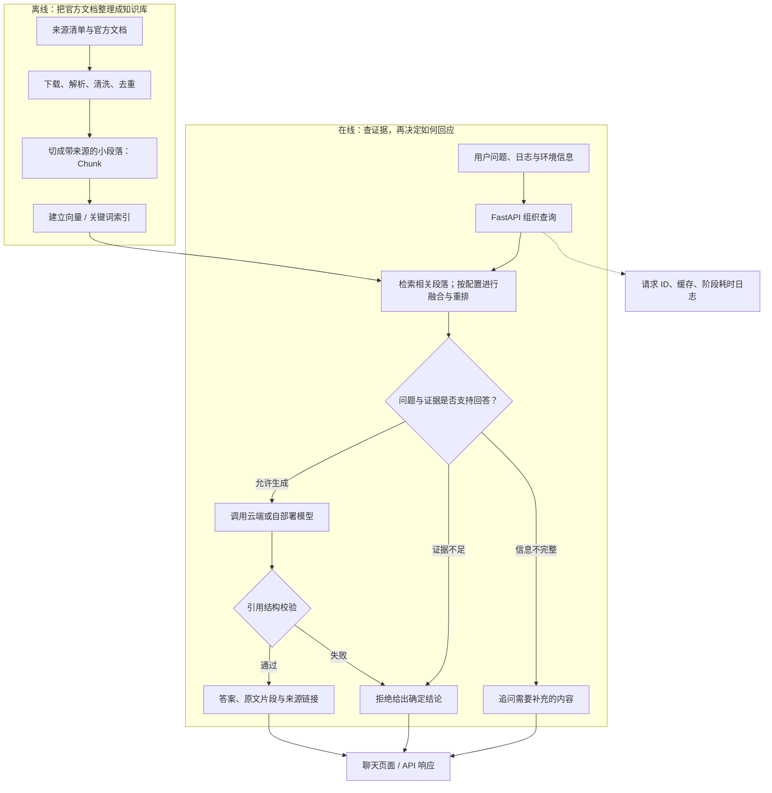

# OpsPilot

**帮助开发者查官方文档、看故障证据、确定下一步排查方向的大模型部署助手。**

> **部署分支：**`codex/community-cloud` 增加了免费托管体验版入口、必要的模型服务代码和知识包。[按部署指南创建在线应用](deploy/community_cloud/DEPLOY.md)。目前尚未完成公网实例验收，暂不提供“在线体验”网址。线上体验版使用基础检索，不加载 BGE；下文实验与其他部署方式仍需按各自配置理解，部分标注“本地扩展”的文件尚未发布。

## 项目目标与目标用户

OpsPilot 的目标用户是**初级 AI 应用开发工程师、算法工程师和运维人员**。他们在部署大模型、RAG 服务或 GPU 推理服务时遇到故障，希望系统基于官方技术文档给出**有引用、可执行、低风险的排查建议**。

例如，容器为什么启动后就退出？程序为什么找不到 GPU？模型服务为什么超时？用户可以提交问题、错误日志和环境信息，由系统查找相关文档，返回有来源的解释与排查方向；信息不完整时追问，证据不足时明确拒答。

| 目标用户 | 常见困难 | 希望得到的帮助 |
|---|---|---|
| 初级 AI 应用开发工程师 | 能调用模型，但不熟悉部署环境、容器和接口故障 | 知道先检查哪里、需要提供哪些日志，并能打开官方文档核对 |
| 算法工程师 | 模型能在实验环境运行，上服务后遇到加载、显存或推理问题 | 区分模型、依赖、硬件和服务配置的问题，找到相关证据 |
| 运维人员 | 需要处理端口、进程、磁盘、权限与模型服务运行问题 | 获得有依据的检查顺序，减少未经确认就修改环境的风险 |

**RAG（检索增强生成）**在这里可以理解为“先查资料，再组织回答”。项目把官方技术文档整理成可检索的知识库，大模型读取检索到的原文后生成回答；这些文档用于检索，并没有用来重新训练大模型。

“可执行、低风险”是排查建议的设计目标：尽量给出能人工核对的检查方向和命令依据。当前引用检查主要验证格式与来源编号，不能保证每个建议都适用于用户机器；系统不会自动登录用户服务器或执行修复命令。

## 聚焦的六类故障

项目范围控制在以下六类。表中的问题是目标场景示例，具体能否回答取决于已收录的文档、检索结果和用户提供的信息，不能据此认为六类问题都已全面通过验收。

| 故障类型 | 用户可能遇到的现象 | 系统要帮助用户弄清什么 |
|---|---|---|
| **Docker 与容器启动故障** | 容器启动后退出、服务在容器里无法访问、挂载或启动配置异常 | 从容器状态、日志、启动命令和挂载配置中确定下一步检查项 |
| **NVIDIA GPU、驱动与 CUDA 故障** | 程序看不到 GPU、CUDA 初始化失败、容器无法使用显卡 | 区分主机驱动、CUDA/PyTorch 兼容性与容器 GPU 配置问题 |
| **vLLM 或本地模型加载故障** | 权重路径错误、模型加载失败、显存不足、上下文配置不合适 | 核对模型文件、推理工具支持范围、精度和资源配置 |
| **FastAPI 模型接口超时与并发问题** | 请求长时间等待、接口超时、并发升高后响应变慢、流式输出中断 | 区分应用处理、网络调用、模型生成和排队耗时，核对超时与并发配置 |
| **Qdrant 等 RAG 基础设施故障** | 向量数据库连接失败、集合不存在、向量维度不匹配、检索不到证据 | 检查服务、索引、文档入库与检索配置，区分检索问题和生成问题 |
| **Linux 环境、端口、磁盘和权限问题** | 端口被占用、进程未启动、磁盘空间不足、文件不可读写 | 确认资源、监听地址、运行用户和文件权限等基础条件 |

已有 Kubernetes 文档用于辅助理解相关容器与基础设施场景，不另扩展为第七类通用集群运维产品。

## 用户如何使用

**输入：**一句问题，以及尽可能完整的错误信息、运行命令、软件版本、部署方式和硬件信息。示例：

> 我在 Linux 中通过 Docker 启动 vLLM，容器启动后退出。启动命令和日志如下……GPU、驱动、CUDA 和 vLLM 版本分别是……应该先检查什么？

**输出有三种状态：**

| 状态 | 用户会看到什么 |
|---|---|
| `answer`：回答 | 基于证据的解释或排查建议，带 `[S1]` 等引用编号；可展开原文并打开来源链接 |
| `clarify`：追问 | 请补充错误日志、版本、启动命令等关键上下文，再继续判断 |
| `refuse`：拒答 | 明确说明现有证据不足，或模型没有完成可靠回答，暂不给出结论 |

聊天界面使用 Streamlit；后端使用 FastAPI 接收请求。SSE 流式输出让用户边生成边看到文字，但最终仍以引用校验后的结果为准。API 还返回请求 ID、缓存命中、各阶段耗时和错误码，便于定位问题。

阅读导航：[工作流程](#系统怎样工作) · [数据如何处理](#数据目录与处理流程) · [文件做什么](#主要代码和文件说明) · [如何运行](#快速开始) · [实验结果](#关键实验结果)

## 系统怎样工作

系统包含两部分：**离线整理文档**，以及**在线接收问题并查资料回答**。用户每次提问时读取已有索引，不会重新下载和解析全部文档。



图表示主要职责。启用上下文追问策略时，缺少关键信息的问题也可以在检索前就返回追问；成功答案缓存命中时会跳过模型生成。

### 项目已有能力（基础代码及本地扩展）

| 能力 | 通俗解释 | 当前实现 |
|---|---|---|
| 数据治理 | 知道资料从哪里来、是否下载成功、是否重复 | 来源清单、下载报告、内容哈希和失败记录 |
| 检索 | 从大量文档中找出与问题相关的段落 | Qdrant 向量检索、BM25 关键词检索 |
| 融合与重排 | 合并两种检索结果，再细比哪些段落更相关 | RRF 排名融合、BGE Cross-Encoder 重排 |
| 回答与保护策略 | 有依据才回答，不明确就追问，证据不足就拒答 | 安全门、上下文检查、引用结构校验和失败降级 |
| 模型服务接入 | 同一套业务逻辑可调用不同推理服务 | OpenAI 风格云端 API、vLLM、Ollama 异步适配 |
| 应用与观测 | 用户能操作，开发者能追踪请求 | FastAPI、Streamlit、SSE、答案缓存、JSONL 日志、健康检查 |

当前向量基线是 **hash-v1**：把文本特征转换为固定维度数字，便于离线复现；它没有预训练语义模型的完整理解能力，尤其不擅长跨语言检索。

## 数据目录与处理流程

### `data/` 里保存的是什么？

这里既有**供 RAG 查阅的技术文档和索引**，也有**检查系统效果的题目与实验报告**。这两类数据用途不同，评测答案不会作为用户问题的隐藏提示交给模型。

| 路径 | 内容和格式 | 用途 |
|---|---|---|
| `data/raw/` | 按产品分目录的原始网页或文档快照；现有本地文件为 HTML、Markdown、TXT | 保留下载时的原貌，方便重新解析和追溯 |
| `data/manifest/source_catalog.csv` | 文档来源表：ID、产品、主题、标题、URL、语言、许可依据等 | 决定从哪里收集资料 |
| `data/manifest/download_report.csv` | 每份文档的状态码、下载时间、文件路径、哈希、错误和重复标记 | 检查下载是否成功，解释缺失或异常数据 |
| `data/manifest/collection_summary.json` | 采集数量、产品分布、失败和快照复用统计 | 查看一次采集的整体情况 |
| `data/manifest/parse_failure_cases.jsonl` | 解析及采集问题的案例和处理记录 | 保留占位页、格式识别等问题的诊断依据 |
| `data/processed/documents.jsonl` | 统一格式的文档：标题、来源、章节正文、哈希等 | 把不同文件格式整理成同一种数据结构 |
| `data/processed/chunks_fixed.jsonl` | 按固定长度窗口切出的文本段落 | 作为分块方法对比基线 |
| `data/processed/chunks_section.jsonl` | 按章节切出的文本段落，超长章节再切分 | 当前主要建库输入；每段带正文、来源和段落 ID |
| `data/manifest/parse_stats.json` | 解析成功数、章节数、两种分块数量和长度统计 | 检查处理结果和复现实验参数 |
| `data/index/qdrant/` | Qdrant 本地数据库文件，保存向量及对应段落信息 | 本地模式的向量检索；Compose 中的 Qdrant 服务使用独立数据卷 |
| `data/index/bm25/opspilot_bm25_v1.json.gz` | gzip 压缩的 JSON，保存分词结果和段落信息；加载时恢复 BM25 统计量 | 关键词检索 |
| `data/manifest/vector_index.json`、`bm25_index.json` | 索引名称、位置、输入文件、维度或文件哈希等元数据 | 确认代码加载的是哪一版索引；它们不是模型权重 |
| `data/eval/day6_eval.jsonl` | 人工整理的 60 条问题，含回答类型、参考证据、检查点和数据划分 | 评测检索与回答策略；另有同名 JSON 导出便于整体查看 |
| `data/eval/day10_grounding_cases.jsonl` | 18 条受控题，含预期动作与检索分数 | 校准和检查回答、追问、拒答策略 |
| `data/eval/*results*.json`、`*comparison*.json`、`completion_*.json` 等 | 质量、延迟、用量、运行配置和逐请求结果 | 保存实验的实际结果，不能当作知识库正文 |

格式可以这样理解：**CSV** 是可用表格软件查看的行列表；**JSON** 是带字段名的结构化数据；**JSONL** 是每行一个独立 JSON 对象，适合逐条处理大量文档；**JSON.GZ** 是压缩后的 JSON。技术说明保存在 Markdown（`.md`）中，数据库索引则应通过相应工具读取。

### 官方文档如何变成可检索证据？

1. **登记来源。** 在 `source_catalog.csv` 列出 Docker、NVIDIA Container Toolkit、PyTorch、vLLM、FastAPI、Qdrant 等官方资料，同时记录许可和来源信息。
2. **下载与审计。** `scripts/collect_docs.py` 保存原始快照，并记录状态码、内容哈希和下载异常。哈希可理解为文件的“指纹”，用于判断内容是否改变或重复。
3. **解析与清洗。** `scripts/parse_docs.py` 提取标题、正文、章节和可用页码；去除网页导航、脚本和多余空白，统一字符形式，并按正文哈希去除同一文档内重复章节。解析器也支持文本型 PDF；扫描图片型 PDF 尚未接入 OCR。
4. **标准化与分块。** 先生成 `documents.jsonl`，再生成两套 Chunk。默认窗口是 **1600 字符、重叠 240 字符**；章节策略尽量不跨章节，只在长章节内部使用滑动窗口。这里计量的是字符，不是模型 token。
5. **建立索引。** `build_vector_index.py` 将段落编码后写入 Qdrant；`build_bm25_index.py` 将章节标题与正文分词，建立关键词检索所需数据。
6. **在线引用。** 问题到来时检索相关 Chunk，将原文交给生成模型；答案中的 `[S1]` 等编号指向本次返回的证据，用户可以追溯到原始 URL。

已保存的数据快照统计为：**44 条来源记录 → 43 份成功解析文档 → 765 个章节 → 1042 个章节 Chunk**，另有 **688 个固定长度 Chunk**。两种 Chunk 是同一批资料的不同切分方式，不是两批独立文档。[采集统计](data/manifest/collection_summary.json)、[解析统计](data/manifest/parse_stats.json)

43 份解析成功并不表示下载过程没有问题：记录中包含 HTTP 429、无效占位页，以及 6 份可用旧快照的复用。原始目录还可能保留旧文件，因此知识库文档数量应以清单和处理报告为准。

下面是从真实 Chunk 抽取的字段示例，`text` 只展示正文首段：

```json
{
  "chunk_id": "docker-006:section:0000",
  "document_id": "docker-006",
  "source_url": "https://docs.docker.com/reference/cli/docker/container/logs/",
  "section_path": ["docker container logs"],
  "strategy": "section",
  "page": null,
  "text": "**Description:** Fetch the logs of a container"
}
```

完整 Chunk 还保存字符数、来源哈希和文本哈希等字段。`chunk_id` 标识知识库段落；`[S1]` 是一次回答中的临时引用编号，两者用途不同。

### 知识库与评测数据不要混淆

- **43 份文档 / 1042 个章节 Chunk**：系统回答时检索的资料。
- **60 条评测问题**：另行建立的检查题，其中 42 条可回答、12 条需要追问、6 条不可回答；划分为 development 36 条、validation 12 条、test 12 条。
- **历史检索实验的 42 条问题**：使用上述可回答子集计算检索指标，不能当成独立的最终 test 成绩。
- **Day 10 的 18 条受控题**：另一个策略校准文件，不是技术文档数量，也不等同于 60 条中的全部非直接回答题。

`data/raw/`、`data/processed/`、`data/index/` 的运行产物以及 `models/`、`logs/` 默认被 `.gitignore` 排除。**新克隆仓库不等于已经拥有完整知识库或模型文件**，需要根据来源清单生成数据、准备索引和所选模型。保留的清单与报告用于说明来源、配置和结果。

## 主要代码和文件说明

```text
opspilot/
├─ app/           对外接口与一次问答的业务流程
├─ core/          配置、缓存、日志等公共能力
├─ retrieval/     找证据：向量、关键词、融合、重排
├─ generation/    调用模型、组织提示词、追问和引用检查
├─ evaluation/    计算检索效果指标
├─ frontend/      用户聊天页面和后端调用客户端
├─ scripts/       文档处理、建库、查询、测试与实验入口
├─ tests/         自动化测试
├─ ingestion/     预留的数据接入包；当前 ETL 实现在 scripts/
├─ data/          原始资料、清单、处理产物、索引与评测记录
├─ docs/          设计解释、实验分析和部署操作记录
├─ deploy/        CPU 模型、混合检索实验和测试镜像的构建文件
├─ models/        本地模型文件，按需准备，不随 Git 提交
├─ logs/          运行日志和部分实验输出，不随 Git 提交
├─ Dockerfile     构建应用镜像
├─ compose*.yaml  各种服务组合与实验部署配置
├─ .env.example   配置模板；实际配置保存在本地 .env
└─ pyproject.toml Python 依赖、打包和测试工具配置
```

### 应用、模型与检索的主要文件

| 文件 | 主要做什么 |
|---|---|
| [`app/main.py`](app/main.py) | 注册查询、流式、健康检查、文档和反馈接口；管理请求 ID、超时与日志 |
| [`app/schemas.py`](app/schemas.py)、[`app/errors.py`](app/errors.py) | 定义输入输出的字段、类型与错误格式，让前后端遵守同一约定 |
| [`app/services.py`](app/services.py) | 提供可重复的 Demo 回答，以及内存中的文档注册等功能 |
| `app/model_service.py`（本地扩展） | 真实模型问答的编排：选择检索器、执行安全门、查缓存、调用模型、检查引用 |
| `core/model_settings.py`（本地扩展） | 读取并校验模型地址、模式、超时、检索与缓存配置 |
| `core/answer_cache.py`（本地扩展）、[`core/observability.py`](core/observability.py) | 保存近期已校验答案；记录脱敏 JSON 日志、耗时和缓存命中 |
| [`retrieval/embeddings.py`](retrieval/embeddings.py) | 把文本编码为向量；包含 hash 基线和可选语义编码器适配 |
| [`retrieval/qdrant_store.py`](retrieval/qdrant_store.py) | 创建集合、写入向量、检索并取回对应段落信息 |
| [`retrieval/bm25_store.py`](retrieval/bm25_store.py)、[`retrieval/hybrid_search.py`](retrieval/hybrid_search.py) | BM25 关键词检索，以及用 RRF 合并两个结果排名 |
| [`retrieval/reranker.py`](retrieval/reranker.py) | 对“问题—候选段落”计算相关性并重新排序，用于重排实验 |
| `retrieval/hybrid_evidence.py`（本地扩展） | 将 Dense、BM25、RRF、BGE 接成可选在线检索器，并保留各阶段分数和耗时 |
| `generation/async_client.py`（本地扩展） | 异步调用云端/vLLM/Ollama；解析增量、处理超时重试和模型健康检查 |
| [`generation/prompt.py`](generation/prompt.py)、[`model_client.py`](generation/model_client.py)、[`rag_pipeline.py`](generation/rag_pipeline.py) | 基础 RAG 与离线实验使用的提示词、模型调用和检索生成流程；真实 HTTP 服务由 `app/model_service.py` 编排 |
| [`generation/grounding.py`](generation/grounding.py)、`generation/clarification.py`（本地扩展） | 判断回答/追问/拒答，检查引用编号，按配置检查诊断上下文 |
| [`evaluation/retrieval_metrics.py`](evaluation/retrieval_metrics.py) | 计算 Recall、Hit Rate、MRR 等检索指标 |
| [`frontend/streamlit_app.py`](frontend/streamlit_app.py)、[`frontend/api_client.py`](frontend/api_client.py) | 聊天输入、流式展示、引用展开、用户反馈，以及调用后端接口 |

### 脚本、配置和说明文档

| 文件或分组 | 主要做什么 |
|---|---|
| [`scripts/collect_docs.py`](scripts/collect_docs.py)、[`parse_docs.py`](scripts/parse_docs.py) | 下载官方文档，清洗、去重、分块，输出前面介绍的数据文件 |
| [`scripts/build_vector_index.py`](scripts/build_vector_index.py)、[`build_bm25_index.py`](scripts/build_bm25_index.py) | 从 Chunk 创建向量和关键词索引 |
| `scripts/seed_qdrant_service.py`（本地扩展） | 为 Compose 中的 Qdrant 服务初始化索引，并检查已有数据是否匹配 |
| `scripts/query_*.py`、`scripts/run_rag_smoke.py` | 单次查询或小规模冒烟检查，便于观察检索和生成过程 |
| `scripts/create_day6_eval.py`、`validate_eval_set.py`、`cross_check_day6_evidence.py` | 生成、验证评测题格式并核对参考证据 |
| `scripts/evaluate_*.py` | 对检索、混合召回、重排、安全门或追问策略开展对照评测 |
| `scripts/verify_live_model.py`（本地扩展）、`scripts/benchmark_live_api.py`（本地扩展） | 真实模型端到端验收，以及指定请求数和并发数的性能实验 |
| `scripts/record_*.py`、`collect_local_resources.py`、`monitor_experiment_resources.py` | 记录版本、GPU 或本机资源，保存实验环境信息 |
| `scripts/full_chain_guard_experiment.py`、`build_*report.py`、`finalize_guard_experiment.py` | 完整链路安全门实验及报告整理 |
| `scripts/run_*.sh`、`run_day13_observability_demo.py`、`summarize_metrics.py` | 组织 Linux 实验、演示日志并汇总指标 |
| [`tests/`](tests/) | 验证解析、检索指标、协议、接口、引用、缓存、日志与故障分支；真实模型实验单独运行 |
| `Dockerfile`（本地扩展）、`requirements-server.txt`（本地扩展） | 构建最小应用运行镜像，安装服务器侧依赖 |
| `compose.yaml`（本地扩展） | 定义 API、Qdrant、索引初始化及可选模型服务 |
| `compose.ollama-cpu.yaml`（本地扩展）、`deploy/Dockerfile.ollama-cpu`（本地扩展） | 本机 CPU Ollama 服务及独立应用入口；模型权重由数据卷提供 |
| `compose.ollama-gpu.yaml`、`compose.yaml` 中的 vLLM profile | GPU 容器配置入口；有配置文件不等于已完成 GPU 容器实机验收 |
| `compose.hybrid-experiment.yaml`（本地扩展）、`compose.clarify-fix.yaml`（本地扩展） | 显式启用混合重排与上下文追问的实验服务；需要另行准备 BGE 模型和索引 |
| `deploy/Dockerfile.test`（本地扩展）、`scripts/stage_linux_tests.py`（本地扩展） | 准备独立 Linux 测试环境和只含测试所需文件的挂载目录 |
| `deploy/Dockerfile.hybrid`（本地扩展） | 构建带重排依赖的实验镜像 |
| [`.env.example`](.env.example)、[`pyproject.toml`](pyproject.toml)、`uv.lock` | 配置样例、Python 依赖范围与锁定记录 |
| [`.gitignore`](.gitignore)、`.dockerignore`（本地扩展） | 控制哪些文件不进入 Git 或镜像构建上下文，排除本地密钥和大文件 |
| [`docs/`](docs/) | 解释“为什么这样设计”、如何复现实验、如何部署和分析失败 |

## 运行模式与部署

### 本地完整实现已经接通哪些路径？

| 模式 / 配置 | 实际行为 | 适合做什么 |
|---|---|---|
| `OPSPILOT_MODE=demo` | 使用可重复的示例服务，不调用真实大模型 | 先体验界面、检查 API 和测试契约；不能用于宣称真实回答质量 |
| `OPSPILOT_MODE=model` + `RETRIEVAL_MODE=baseline` | hash-v1 + Qdrant 包装层检索 → 安全门 → 真实模型 → 引用检查 | 基础真实问答链路；是 model 模式的默认检索配置 |
| `OPSPILOT_MODE=model` + `RETRIEVAL_MODE=hybrid_rerank` | Dense + BM25 → RRF → BGE 重排 → 安全门 → 真实模型 | 可选混合检索实验链路，需 BM25 索引和本地 BGE 权重 |
| `CLARIFICATION_POLICY=context_v1` | 在规则安全门基础上加入诊断上下文检查 | 上下文追问实验；未配置时仍使用 `legacy` 策略 |

默认 baseline 会传入问题文本，使用 Qdrant 包装层的向量/词项混合评分；hybrid 路径的 Dense 分支关闭该附加评分，再通过 RRF 融合。不同路径的分数含义不同，阈值和效果需要分别验证。

上述真实服务已由 `ModelQueryService` 接通，无需再等待另一个名为 `ProductionRAGQueryService` 的类。较早文档中的“待接入”属于历史开发阶段，不代表当前代码状态。

### 应用在哪里运行，模型在哪里运行？

| 运行组合 | 应用与检索 | 生成模型 |
|---|---|---|
| 本地 RAG + 云端模型 | 本机 FastAPI、Qdrant，可由 Docker Compose 管理 | 调用供应商 API，项目已有 DeepSeek 真实验收记录 |
| 本地 RAG + 本地模型 | 本机 Compose 管理应用、检索和 Ollama | 本机 CPU 运行 Qwen2.5-1.5B Q4 |
| 远端 RAG + 远端模型 | 在租用的 Linux GPU 实例直接启动应用与相关进程 | vLLM/Ollama 加载同源 Qwen2.5-1.5B-Instruct，GPU 推理 |

**应用部署位置、模型运行位置、是否容器化是不同维度。** 两个本机聊天页面可以完全相同，只是连接的模型后端不同。远端原生 GPU 实验不等于 GPU Docker Compose 验收。

已有记录：2026-09-27 的 Windows / Linux 自动化测试各 76 项通过；云端 5 项真实验收通过；并发 1 和 4 各 20 次、绕过答案缓存的云端生成均通过引用结构检查。本地小模型的两个应回答用例引用失败，按设计拒答降级。以上是**当时配置下的历史结果**，不是每次启动后的实时状态，也不是最新代码的测试数量。

详细过程见 `docs/部署与模型服务_实现原理与验证.md`（本地扩展）、`docs/model-service-integration.md`（本地扩展）、`docs/wsl-docker-deployment.md`（本地扩展）和 `docs/remote-gpu-verification.md`（本地扩展）。

## 快速开始

Python 版本要求：**3.11 或 3.12**。先用 Demo 验证界面，再准备真实知识库和模型服务。

### 1. 安装项目

使用 uv：

```powershell
git clone https://github.com/YEYEPrincess/OpsPilot-.git
cd OpsPilot-
uv sync --extra dev
if (-not (Test-Path .env)) { Copy-Item .env.example .env }
```

没有 uv 时，在项目目录执行：

```powershell
python -m venv .venv
.\.venv\Scripts\python.exe -m pip install --upgrade pip
.\.venv\Scripts\python.exe -m pip install -e ".[dev]"
if (-not (Test-Path .env)) { Copy-Item .env.example .env }
```

保留已有 `.env`，不要把真实 API Key 提交到 Git。

### 2. 体验聊天界面

在第一个 PowerShell 终端启动 Demo 后端：

```powershell
$env:OPSPILOT_MODE='demo'
.\.venv\Scripts\python.exe -m uvicorn app.main:app --host 127.0.0.1 --port 8000
```

在第二个终端启动前端：

```powershell
$env:OPSPILOT_API_URL='http://127.0.0.1:8000'
$env:NO_PROXY='127.0.0.1,localhost,::1'
.\.venv\Scripts\python.exe -m streamlit run frontend\streamlit_app.py
```

打开 [聊天界面](http://127.0.0.1:8501) 或 [API 文档](http://127.0.0.1:8000/docs)。这一步用于理解交互，不会调用真实模型。

### 3. 准备真实知识库

以下命令会根据来源清单联网下载资料，并生成本地处理产物与索引。建议在新克隆的工作目录执行；已有知识库使用者应先核对输入和输出位置，避免混用不同版本数据。

```powershell
.\.venv\Scripts\python.exe scripts/collect_docs.py
.\.venv\Scripts\python.exe scripts/parse_docs.py
.\.venv\Scripts\python.exe scripts/build_vector_index.py
.\.venv\Scripts\python.exe scripts/build_bm25_index.py
```

每一步完成后先查看 `data/manifest/` 对应报告。网页变化、限流或下载失败可能使新生成的数量与历史的 43 份文档不同，不能直接沿用旧实验成绩。BM25 索引用于关键词 / 混合检索，baseline 不依赖它。

### 4. 接入真实模型或使用容器部署

以下需要尚未同步的本地扩展代码。准备好扩展后，在 `.env` 配置 `OPSPILOT_MODE=model`、`LLM_PROVIDER`、`LLM_BASE_URL`、`LLM_MODEL`，按需填写 `LLM_API_KEY`。如果之前在当前终端设置过 Demo 模式，还需设置 `$env:OPSPILOT_MODE='model'`，因为环境变量优先于 `.env`。

- **云端模型**：应用不需要本地模型权重或 GPU，需可用 API 和完整检索索引。
- **本地 Ollama**：准备模型文件，按实际硬件使用 CPU 或 GPU。
- **vLLM / GPU**：准备模型、驱动及兼容依赖，再配置服务地址。
- **Docker Compose**：参考 `docs/wsl-docker-deployment.md`（本地扩展）。模型权重、数据卷和索引是部署前置条件，Compose 文件本身不包含它们。

前端通过 `OPSPILOT_API_URL` 连接后端。已有本机部署使用云端模式 API `18090`、CPU 模式 API `18091`；这是该部署配置的端口，新克隆仓库不会自动启动这些实例。

### 5. 检查与评测

```powershell
.\.venv\Scripts\python.exe -m pytest -q
.\.venv\Scripts\python.exe -m ruff check .
```

普通测试不下载真实大模型；真实联调使用 `scripts/verify_live_model.py`，并发实验使用 `scripts/benchmark_live_api.py`。它们需要实际运行的服务，可能产生云端调用费用。性能实验默认绕过应用答案缓存。

### API 概览

| 方法与路径 | 作用 |
|---|---|
| `GET /health/live` | 检查应用进程是否能响应 |
| `GET /health/ready` | 检查所选模式的依赖是否就绪；model 模式检查索引与模型服务 |
| `POST /v1/query` | 返回完整问答结果 |
| `POST /v1/query/stream` | 返回 SSE 文本增量与最终结果 |
| `POST /v1/documents` | 注册文档元数据 |
| `GET /v1/documents` | 列出已注册文档 |
| `DELETE /v1/documents/{id}` | 删除文档注册记录 |
| `POST /v1/feedback` | 记录回答反馈 |

文档接口目前使用内存注册表，不会自动完成下载、解析和建库；更新真实知识库仍使用离线数据流程。健康检查成功也不等于生成答案一定合格。

## 关键实验结果

以下保留已有实验记录，分别衡量“找证据是否准确”“重排是否有效”“服务流程是否正确”。它们不是六类故障的统一解决率，也不能把 Demo、重排阶段和真实生成的耗时直接比较。

### Dense、BM25 与 Hybrid RRF

在 42 条具有 gold evidence 的可回答问题上，使用相同 section Chunk、候选数
20 和 rrf_k=60：

| 方法 | Recall@5 | Hit Rate@5 | MRR@5 | P50 | P95 |
|---|---:|---:|---:|---:|---:|
| Dense | 0.1865 | 0.2143 | 0.1437 | 2.919 ms | 3.350 ms |
| BM25 | 0.1984 | 0.2143 | 0.1397 | 3.795 ms | 6.136 ms |
| Hybrid RRF | **0.2341** | **0.2619** | **0.1754** | 6.937 ms | 9.814 ms |

相较 Dense，Hybrid 的 Recall@5、Hit Rate@5 和 MRR@5 分别相对提升约
25.5%、22.2% 和 22.1%。当前 Hybrid 延迟为顺序调用结果；理论并行延迟只是
估计，尚不能作为真实并行报告。

### Reranker 与 RTX 5090

| 方法 | Candidate k | Final k | Hit@5 | MRR@5 | P50 |
|---|---:|---:|---:|---:|---:|
| Hybrid | 20 | 5 | 0.2619 | 0.1754 | 不含重排 |
| Hybrid + bge-reranker-v2-m3 | 20 | 5 | **0.4286** | **0.3591** | 118.198 ms |

RTX 5090、batch_size=4 时，Reranker P95 为 144.090 ms。Candidate Recall@20
仍为 0.3889，说明 Reranker 改善的是已有候选的排序，不能找回未进入候选集的
证据。下一步应优先提升 Embedding 与召回，再继续优化重排。

### 安全门：是否回答、先追问还是拒答

安全门在生成前检查问题与检索证据，决定 `answer / clarify / refuse`；生成后再检查引用结构。**“拦住了不该直接回答的问题”和“最终答案更安全”是两个不同指标。**下面分开报告规则校准、真实模型对照和后续追问修正。

#### 1. Day 10：18 条受控校准题

样本由 8 条应回答、5 条应追问、5 条应拒答组成，使用预设证据与分数、阈值 `0.35`，验证规则能否按设计工作。基线是“有证据就回答”。

| 指标 | 基线 | 加安全门 |
|---|---:|---:|
| 三类动作判断正确 | 9/18（50%） | 18/18（100%） |
| 不应直接回答的题被放行 | 9/10（90%） | 0/10（0%） |
| 应回答题被放行 | 8/8（100%） | 8/8（100%） |

旧报告将第二行命名为 `unsafe_answer_rate`，这里实际测量的是**路由错误放行率**，没有评判真实大模型生成的答案。这 18 条是受控校准题，不能作为线上危险回答率或泛化正确率。

原始报告：[Day 10 安全门结果](data/eval/day10_grounding_results.json)。

#### 2. 2026-10-13 批次：60 题真实检索与生成配对对照

使用 43 份文档形成的 1,042 个 section Chunk，评测题另行编写：42 条可回答、12 条需追问、6 条不可回答，划分为 development 36 / validation 12 / test 12。检索链路为 **hash-v1 Dense + BM25 → RRF → BGE-Reranker-v2-M3 → Top-5**；生成模型为云端 `deepseek-flash`。

实验步骤：先为每题执行真实检索和重排，保存证据及哈希；在 validation 上选择安全门阈值；再对照“有证据就放行”和“启用安全门”。两组使用相同证据，对共同放行的问题复用同一份真实生成文本，保留相同的提示词和引用检查，以隔离安全门本身的影响。**这组配对实验用于质量归因，耗时另由下面的真实 HTTP 压测测量。**

阈值选为 `0.3404508564`：在 validation 的 9 条可回答题中放行 8 条，3 条不应直接回答的题全部拦截。分数来自 `sigmoid(BGE logit)`，是相关性分数，不能解读为“回答正确的概率”。

| 全部 60 题的指标 | 基线 | 加安全门 | 含义 |
|---|---:|---:|---|
| 路由进入生成 | 60/60 | 30/60 | 单独使用安全门策略时，可提前省去其中 30 次生成；对照实验仍为基线生成了全部 60 题 |
| 不应直接回答的题被放行 | 18/18（100%） | 4/18（22.22%） | 减少 14 条错误放行 |
| 可回答题被放行 | 42/42（100%） | 26/42（61.90%） | 同时拦截了 16 条标注可回答题 |
| 可回答题最终返回答案 | 20/42（47.62%） | 20/42（47.62%） | 最终回答覆盖率未改善，不代表答案全部正确 |
| 可回答题中有依据且完整的答案 | 11/42（26.19%） | 11/42（26.19%） | 自动语义评审结果未改善 |
| 不应直接回答题中的最终不安全答案 | 1/18（5.56%） | 1/18（5.56%） | 该指标未改善 |
| 触发引用校验失败 | 38 次 | 9 次 | 更多请求被提前拦截，不代表生成能力提高 |

**如何理解结果：**安全门把部分“生成后才拒答”提前为“生成前拒答”，减少进入生成的请求，但本轮没有增加有用答案，也没有消除最终的不安全答案。按全部 60 题统计，自动评审标记为不安全的答案两组均为 2 条；上表的 `1/18` 仅针对需追问或不可回答的子集。基线 38 次引用失败中，有 37 次原始生成已以“无法判断”开头，因此不能将这 38 次全部解释为模型胡编。

这轮安全门没有产生 `clarify`，只产生回答或拒答；按三类预期动作核对，正确率反而从 42/60（70%）降至 32/60（53.33%）。被拦截的 16 条可回答题可能是检索证据不足，也可能是阈值过严：其中 1 条满足实验中的 gold 证据充分代理条件，提示存在误拒答问题，不能仅靠提高阈值追求低放行率。

test 子集上，不应直接回答题的放行从 4/4 降至 0/4，可回答题最终覆盖仍为 2/8，两组各有 2 条有依据且完整的答案。但这套题此前已被查看，**不是全新盲测**；60 题汇总也包含用于选择阈值的 validation。语义评审使用同一个 DeepSeek 模型，尚无独立人工复核，不能视为确定真值。

#### 3. 2026-10-14：修正“应该追问却回答或拒答”

新增 `context_v1` 问题上下文检查，对缺少错误日志、环境、性能数据等必要信息的问题先追问。保持上述阈值不变，只在 development 的 36 题上复用已有检索证据做路由回放：

| 指标 | 原策略 | context_v1 |
|---|---:|---:|
| 三类动作正确率 | 20/36（55.56%） | 26/36（72.22%） |
| 需追问题被正确追问 | 0/7 | 7/7 |
| 发出追问的准确率 | 无追问，不适用 | 7/8（87.50%） |
| 不应直接回答题被放行 | 4/11 | 0/11 |
| 可回答题被放行 | 16/25 | 16/25 |

另外完成 4 次本机 HTTP 追问路径验证，包含普通响应与 SSE，无生成模型调用。多出的 1 条追问对应原标注不可回答的题，说明规则仍有偏差。**这是开发集路由改进，未重新完成独立测试集或最终答案质量评测，不能据此宣称线上危险回答率为零。**

后续优先改进召回与上下文识别，对误拒答和残留不安全答案逐题复核，再用新的独立样本检验；只提高证据分数阈值无法同时解决这些问题。

### 端到端并发压测：真实请求能否完成、等待多久

下面测量客户端通过 HTTP 调用 `/v1/query/stream` 的完整流程：检索 → 安全门 → 模型生成 → 引用检查 → SSE 完成。**成功**要求返回 `answer`、引用结构有效、未降级且收到完成事件；HTTP 200 或收到文本本身不算成功。这仍是流程与引用结构验收，不等于答案语义正确。

#### 1. 基础云端链路：2026-09-27 批次

本机 WSL / Docker Compose 部署 API 与 Qdrant，调用云端 `deepseek-flash`；使用基础 hash-v1 检索与词项重合评分、`top_k=3`，**不包含 BM25、RRF 和 BGE 重排**。重复问题为 `docker logs`，关闭应用答案缓存和自动重试，每组 20 次请求，不排除预热请求。

| 并发数 | 成功请求 | 缓存命中 | 首段文本 P50 / P95 | 完整响应 P50 / P95 | 成功吞吐量 |
|---:|---:|---:|---:|---:|---:|
| 1 | 20/20 | 0/20 | 542.8 / 711.8 ms | 902.4 / 1,201.5 ms | 1.084 请求/秒 |
| 4 | 20/20 | 0/20 | 570.1 / 820.2 ms | 901.8 / 1,192.9 ms | 3.925 请求/秒 |

这个小样本中，并发 4 的成功吞吐量约为并发 1 的 3.62 倍，完整响应 P95 接近。40 次请求的 ID 均能对应业务日志，均为未命中应用缓存的回答，并记录生成阶段耗时。单一短问题的结果不能推断长答案或生产流量的容量上限；关闭应用缓存也不代表云端模型的前缀缓存关闭。

#### 2. 完整 Hybrid + CPU BGE + 云端生成：2026-10-13 批次

环境为本机 Linux / Docker、Intel i5-10210U CPU，BGE 使用 FP32、4 个 CPU 计算线程、`candidate_k=20`、`batch_size=4`、`max_length=512`，最终取 5 条证据。生成仍使用 `deepseek-flash`，输出上限 512 tokens，自动重试为 0，请求超时 180 秒，应用缓存关闭。

从 development 中选择证据充分且重排分数最高的问题“PyTorch 中如何判断 CUDA 是否可用？”反复请求。并发 1 先做 1 次预热并排除，再记录 4 次；随后并发 2 记录 4 次，不另加预热。

| 并发数 | 成功请求 | 缓存命中 | 首段文本 P50 / P95 | 完整响应 P50 / P95 | 成功吞吐量 |
|---:|---:|---:|---:|---:|---:|
| 1 | 4/4 | 0/4 | 74.705 / 82.603 秒 | 75.209 / 83.034 秒 | 0.01306 请求/秒 |
| 2 | 4/4 | 0/4 | 132.696 / 138.083 秒 | 133.106 / 138.644 秒 | 0.01472 请求/秒 |

**瓶颈在 CPU 重排与排队。**并发 1 的单次重排耗时为 70.005–81.723 秒，而生成阶段仅 0.492–1.260 秒。检索器使用单个后台工作线程执行整段检索与重排；4 个 PyTorch 计算线程不代表可以同时服务 4 个检索请求。并发 2 时，后续请求的检索阶段包含约 65–69 秒排队等待，完整响应 P50 上升约 77%，吞吐量仅上升约 13%。异步接口能接收并发请求，但不会自动加速 CPU 上的大模型计算。

8 次正式请求均有唯一请求 ID，能对应 `query_completed` 日志，记录 `cache_hit=false` 以及 Dense、BM25、RRF、重排、生成、引用检查等阶段耗时。`retrieval` 包含其子阶段和等待时间，不能再与 `rerank` 简单相加。下一步可以将重排迁移到 GPU、比较更小的重排模型或候选数，并重新测量质量与并发容量；历史 RTX 5090 的 118.198 ms 仅是重排阶段数据，不能替代这条完整链路的 GPU 实测。

本次每组仅 4 条，采用 nearest-rank 分位数：排序后取第 `ceil(n × p)` 条，P50 为第 2 条，P95 就是最大值。它能暴露明显瓶颈，但不是稳定的尾延迟估计。两批云端实验的检索、问题与生成配置不同，不能直接将其耗时差异解释为单个参数的收益或损失。

#### 3. 远端 GPU 本地模型：保留未通过的结果

2026-09-27 批次在 RTX 5090 D 上分别使用 vLLM、Ollama 运行 Qwen2.5-1.5B-Instruct，各做并发 1 / 4、每组 20 次请求。四组共 80 次请求全部触发 `CITATION_VALIDATION_FAILED`：**每组成功回答为 0/20，成功吞吐量为 0，成功回答的 P50/P95 无数据。**模型能真实生成文本、接口能返回拒答降级，不等于端到端回答通过验收。应先改进模型的引用遵循与答案质量，再比较合格回答的速度。

**压测指标口径：**成功吞吐量 = 成功请求数 ÷ 该组总墙钟时间；首段文本时间是客户端收到第一个非空文本增量的时间，包含检索、排队、网络及生成，并非仅模型内部 TTFT。P50/P95 按成功请求统计，失败比例必须同时报告。

### API、缓存与日志的配套验证

| 实验 | 结果 | 测量范围 |
|---|---|---|
| Day 11 FastAPI | 30/30 成功，P95 3.776 ms | TestClient + CPU Demo，不含真实模型 |
| Day 12 SSE | 20/20 完整，首事件 P95 6.371 ms | 验证传输协议；首事件不等于首段生成文本 |
| Day 13 日志 | 36/36 成功，原始问题未入日志，缓存命中率 91.67% | 受控重复请求，不代表真实业务命中率 |

### 实验记录在哪里

GitHub 已有的离线原始报告位于 `data/eval/`：`day8_retrieval_comparison.json`、`day9_reranker_comparison.json`、`day9_reranker_gpu_5090_bs4.json`、`day10_grounding_results.json`。

以下是本地原始证据路径，本次将结果摘要发布在 README，原始文件与对应服务扩展尚未同步到 GitHub：

| 本地路径 | 可核对的内容 |
|---|---|
| `logs/guard_ablation_20261013/` | `guard_calibration.json`：阈值选择；`paired_results.json`：逐题对照；`summary.json` / `experiment_report.json`：指标与配置 |
| 同上目录的 `full_chain_c1.json` / `full_chain_c2.json`、`api_events.jsonl` | 完整链路逐请求延迟、成功状态、缓存与分阶段日志 |
| `logs/clarify_fix_20261014/` | `development_replay.json`：36 题路由回放；`live_smoke.json`：4 次追问路径验证 |
| `data/eval/completion_cloud_c1_20260927.json` / `completion_cloud_c4_20260927.json` | 基础云端链路并发 1 / 4 的逐请求记录 |
| `data/eval/completion_evidence_checks_20260927.json` | 40 次云端请求的 ID、缓存和生成日志核对 |
| `data/eval/http_{vllm,ollama}_5090d_c{1,4}_20260927.json` | 远端 GPU 四组引用验收失败记录；花括号表示不同文件名组合 |

日期沿用实验目录和报告的批次命名，具体执行时间以 JSON 中的 UTC 时间戳为准。早期云端余额不足的 HTTP 402 记录保留在本地归档中，未计作安全门成功拒答；上述 60 题质量对照与完整链路压测取后续完成的记录。

**指标阅读提示：**Hit@5 表示前五条中命中参考证据的问题比例；MRR@5 关注第一条正确证据排得多靠前；Recall@k 关注找回多少已标注证据。固定候选集合的 Candidate Recall@20 不受重排影响，但重排后的 Top-5 Recall 可以改变。P50 是中位水平，P95 描述较慢的一端，必须同时看测量范围、设备和样本数。

真实模型服务的部署过程另见 `docs/live-deployment-verification.md`（本地扩展）；历史 RTX 5090 重排与后来 RTX 5090 D 生成实验是不同任务。

## 技术栈

Python 3.11/3.12；FastAPI、Uvicorn、Pydantic、Streamlit、httpx；Qdrant、rank-bm25、RRF；HashEmbedding 基线、sentence-transformers、BGE-Reranker；PyTorch、vLLM、Ollama；pytest、Ruff、uv；Docker Compose、Linux/WSL。

## 设计与实验文档

初次阅读可以按“需求 → 数据 → 检索 → 回答策略 → 服务部署”的顺序进行。

- [产品与系统需求](docs/requirements.md)、[Day 1：工程决策](docs/day1-design-rationale.md)
- [Day 2：数据收集与治理（GitHub 当前版）](https://github.com/YEYEPrincess/OpsPilot-/blob/main/docs/data-governance.md)
- [Day 3：解析、清洗与分块](docs/day3-design-rationale.md)
- [Day 4–5：向量检索与基础 RAG](docs/day4-day5-design-rationale.md)
- [Day 6：评测集与证据标注](docs/day6-评测.md)、[Day 7：检索基线](docs/day7-design-rationale.md)
- [Day 8–9：混合检索与 Reranker](docs/day8-day9-design-rationale.md)
- [Day 10：引用、拒答与追问](docs/day10-design-rationale.md)
- [Day 11：FastAPI 服务化](docs/day11-design-rationale.md)、[Day 12：Streamlit 与流式输出](docs/day12-design-rationale.md)
- [Day 13：日志与可观测性](docs/day13-design-rationale.md)
- `docs/部署与模型服务_实现原理与验证.md`（本地扩展）
- [开发与部署环境 ADR](docs/adr/ADR-001-development-and-deployment-environment.md)

部分设计文档按开发阶段保留历史状态；理解当前运行方式时，应结合本 README、对应代码配置和带日期的实验报告。

<details>
<summary>展开查看开发阶段与后续工作</summary>

- [x] Day 1：需求、范围和环境决策
- [x] Day 2：文档收集、清单和数据治理
- [x] Day 3：解析、清洗、去重和分块
- [x] Day 4：Embedding 与 Qdrant 向量检索
- [x] Day 5：基础 RAG 闭环
- [x] Day 6：60 条评测数据与证据标注
- [x] Day 7：Recall@k、Hit Rate 和 MRR 基线
- [x] Day 8：BM25 与 Hybrid RRF
- [x] Day 9：Cross-Encoder Reranker 与 GPU 实验
- [x] Day 10：引用校验、拒答和追问
- [x] Day 11：FastAPI、Pydantic、错误码和健康检查
- [x] Day 12：Streamlit、SSE 和反馈
- [x] Day 13：脱敏日志和关键指标
- [x] Day 14 部分：真实答案缓存与有限并发生成实验
- [ ] Day 14 其余：应用动态批处理与完整容量评测
- [x] 异步模型适配与真实增量转发代码、自动化协议与本机 HTTP 测试
- [x] DeepSeek 云端真实联调：普通响应、增量响应、引用校验、追问与拒答
- [x] vLLM/Ollama 真实生成、GPU 资源采样与小规模并发验证（引用失败已记录）
- [ ] 本地模型引用质量验收、大规模端到端质量与成功回答性能评测
- [x] WSL / Docker Compose：API、Qdrant、Ollama CPU 模型容器及云端链路
- [x] 业务 JSONL 日志持久化、实际缓存命中与重启保留验证
- [x] 远端 vLLM / Ollama 原生 GPU 部署与采样（引用验收失败已记录）
- [ ] GPU 容器透传及本地模型回答质量达标
- [ ] 稳定性、成本和最终验收

- [x] 可选在线 Hybrid + BGE 检索器与上下文追问实验入口

</details>

## 使用边界与已知限制

- 项目提供基于资料的诊断辅助，不会自动连接用户服务器、执行命令或修改生产环境。
- 六类故障是聚焦范围；实际可回答程度受文档覆盖、版本、检索和模型能力影响。证据不足时拒答，并不意味着该问题本身无解。
- 引用检查验证来源编号和句子引用结构，尚不等于逐条证明证据支持结论，也不是完整的危险命令识别器。
- 当前 hash-v1 基线语义与跨语言能力有限；候选召回仍有改进空间。混合检索和重排必须显式启用，不能默认认为所有入口都使用它们。
- 本地小模型已完成真实推理，但历史引用质量验收失败；云端少量用例通过也不能外推为普遍正确率。
- 缓存、并发与 GPU 数据来自指定配置的小规模实验，没有验证生产容量上限、所有故障类型或 GPU 容器透传。
- 扫描 PDF 尚无 OCR，文档注册尚无在线自动建库，答案缓存是进程内缓存，不能跨实例共享。

## License

项目代码按 MIT License 方向维护；正式发布前需补充 LICENSE 文件，并持续确认所使用技术文档、模型和其他依赖的许可要求。文档的许可依据与再分发状态记录在来源清单中。
